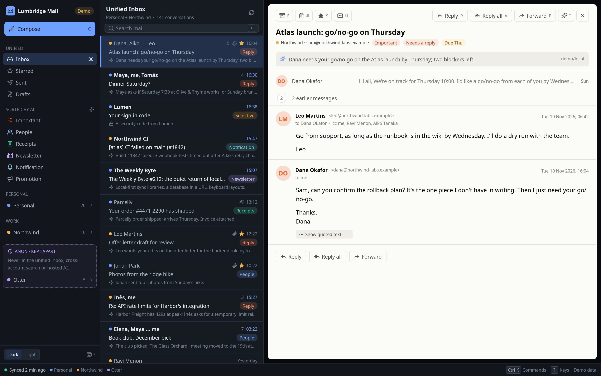

# Lumbridge Mail

A mail client with a daemon, a desktop app (Rust and GPUI) and a command line. It is for people who want
their mail local, keyboard-driven and sorted by a model they choose. Mail is treated as hostile input: rules
run before any model, sensitive mail never reaches one, and nothing is sent unless a person presses Send.

Part of [Lumbridge](https://lumbridgecorp.com) ([all repos](https://github.com/lumbridge-corp)). In testing.



## Status

- **Version:** 0.1.0. Interfaces, the config file and the store format can change until 1.0.
- **Runs on:** Linux x86_64 (Ubuntu 24.04 or newer, X11 or Wayland) and macOS (Apple silicon). The daemon
  and `lbmail` also build for aarch64 Linux servers.
- **Not yet:**
  - Tested end to end on made-up mail only. No live account has been run for long; connect a first account
    read-only.
  - No installer or download: you build it from source.
  - Gmail works only through [`gog`](https://github.com/steipete/gogcli), which you install and sign in
    yourself. IMAP has no OAuth: use an app password.
  - JMAP is not written yet.
  - Opening attachments from a remote daemon in the app.

## Install

You need Rust 1.97 or newer, a C compiler and the GPUI system libraries.

On Ubuntu 24.04:

```sh
sudo apt install build-essential pkg-config libxcb1-dev libxkbcommon-dev libxkbcommon-x11-dev \
  libwayland-dev libvulkan-dev mesa-vulkan-drivers libfontconfig-dev libfreetype-dev libdbus-1-dev \
  libnotify-bin
git clone https://github.com/lumbridge-corp/lumbridge-mail.git
cd lumbridge-mail
cargo build --release --locked -p lumbridge-mail-app -p lumbridge-maild
deploy/install-linux.sh          # --enable also installs and starts the daemon's systemd user unit
```

`deploy/install-linux.sh` needs no sudo. It copies `lumbridge-mail` (the app), `lumbridge-maild` (the
daemon) and `lbmail` (the command line) to `~/.local/bin`, a launcher (`com.lumbridgecorp.mail.desktop`, a
`mailto:` handler; `--default-mailto` makes it the default) and the icon to `~/.local/share`. `PREFIX=...`
moves the install, `--dry-run` shows what it would do. `deploy/install-linux.sh --uninstall` removes it;
config, mail and keyring entries stay.

At run time the app needs a Vulkan driver (Mesa is fine) and fontconfig; the daemon and `lbmail` use the
Secret Service keyring over D-Bus; `notify-send` shows notifications.

On macOS, build the same way, then:

```sh
deploy/app/make-macos-app.sh --install   # Lumbridge Mail.app, with the daemon and lbmail inside, in ~/Applications
```

## Quick start

No account, no daemon and no network:

```sh
lumbridge-mail --demo
```

You see three made-up accounts (personal, work and an anon account kept apart), sorted, with summaries
and a sensitive mail held back from the AI panel. `?` shows the keys, `Ctrl K` the command palette.

With your own mail:

```sh
lumbridge-mail                  # starts lumbridge-maild if it is not running, then offers demo mail or "Add an account"
lbmail account add              # the same from a terminal: IMAP (password to the keyring) or Gmail through gog
lbmail status
lbmail ls
```

AI is off until you name a model server. Any OpenAI-compatible chat endpoint works (vLLM, llama.cpp's
server, Ollama, a hosted API). The smallest config, in `~/.config/lumbridge-mail/config.toml`:

```toml
[ai]
base_url = "http://127.0.0.1:8000/v1"   # up to /v1; /chat/completions is added
model = "my-model"
place = "local"                         # "hosted" for someone else's API: anon accounts never use those
```

Or set `LBMAIL_AI_BASE` and `LBMAIL_AI_MODEL` in the daemon's environment. Without an endpoint, triage runs
on rules only.

## Configuration

| What | Path |
|---|---|
| Config (accounts, AI endpoint, timings) | `~/.config/lumbridge-mail/config.toml` |
| Store and log (`maild.log`) | `~/.local/share/lumbridge-mail/` |
| Socket and person token | `$XDG_RUNTIME_DIR/lumbridge-mail/` |
| Passwords and API keys | the OS keyring |

The settings most people change: `[[accounts]]` (one per address, with a persona: personal, work or anon,
and `readonly`), `[ai]` (the endpoint above), `[daemon] remote` (use a daemon on another machine) and
`[agents] actions` (whether tools without the person token may archive or move mail). Every key is in
[crates/lumbridge-maild/README.md](crates/lumbridge-maild/README.md).

### One daemon on a home server

The daemon and `lbmail` can run on an always-on machine, and the app and `lbmail` elsewhere use it over
ssh: no port is opened. Each client needs `ssh <host>` to work without a password prompt.

```sh
deploy/install-server.sh homeserver --bin-dir <dir with lumbridge-maild and lbmail built for it>
ssh -t homeserver .local/bin/lbmail account add
```

On each client, `~/.config/lumbridge-mail/config.toml` holds only:

```toml
[daemon]
remote = "homeserver"   # an ssh host or ~/.ssh/config alias; "local" or unset = this machine
```

One-off: `lbmail --remote homeserver ls` or `lumbridge-mail --remote homeserver`. When the server cannot be
reached, the app says so and reconnects by itself; nothing is queued on the client. See
[docs/ARCHITECTURE.md](docs/ARCHITECTURE.md), "Remote daemon".

## How it fits the system

Lumbridge Mail works alone. Other Lumbridge parts and your own agents talk to the daemon through
`lbmail` or its JSON-RPC socket, as agents: they can read and draft, but cannot send.

| Works with | What passes between them |
|---|---|
| Any OpenAI-compatible model server | Mail text that the rules allow, wrapped as untrusted data; triage, summaries and drafts back |
| Your agents and scripts | `lbmail` commands or JSON-RPC over the daemon's socket; sensitive mail shows as one line |

## What it sends and where

The daemon connects to the mail servers of the accounts you add (IMAP and SMTP, Resend's or Zoho's API) and
runs `gog` for Gmail accounts. If you set an AI endpoint, it sends mail text there: never sensitive mail
(security codes, password resets, bank and government mail), never anon accounts' mail to a `hosted`
endpoint, and nothing for accounts whose AI you turned off. Remote images in mail load only when you ask.
There is no updater, telemetry or analytics. The daemon listens only on a Unix socket (mode 0600); a remote
daemon is reached over ssh. Mail is stored in SQLite under `~/.local/share/lumbridge-mail/`. An optional
one-way mirror to a Postgres you run is off by default ([docs/MAIL-POSTGRES.md](docs/MAIL-POSTGRES.md)).

## Docs

- [Architecture](docs/ARCHITECTURE.md) — how the daemon, app and providers fit, the protocol, the trust rules
- [Daemon and lbmail](crates/lumbridge-maild/README.md) — every config key and command
- [App](crates/lumbridge-mail-app/README.md) — the app, its keys and screenshots
- [AI layer](crates/lumbridge-mail-ai/README.md) — rules, prompts, the injection checks, the eval
- [Mail in Postgres](docs/MAIL-POSTGRES.md) — the optional mirror
- [Change log](CHANGELOG.md)

## Contributing

Bug reports and small fixes are welcome. Talk to us in an issue before a large change.
See [CONTRIBUTING.md](CONTRIBUTING.md) for how to build, test and send a pull request.

```sh
scripts/ci.sh   # scrub check, clippy, the whole test suite (made-up mail, no display, no network)
```

## Security

Do not open a public issue for a security problem.
Email security@lumbridgecorp.com or use "Report a vulnerability" on this repo's Security tab.
See [SECURITY.md](SECURITY.md) and the trust model in [docs/ARCHITECTURE.md](docs/ARCHITECTURE.md).

## Licence

Apache-2.0. See [LICENSE](LICENSE).

Third-party code keeps its own licence. See [THIRD-PARTY-NOTICES](THIRD-PARTY-NOTICES).
Model weights are not part of this repo and have their own licences.
