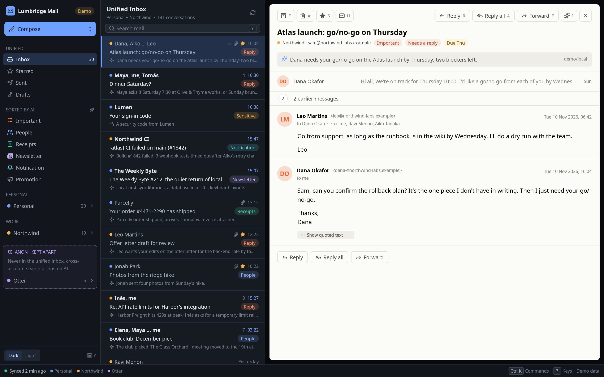
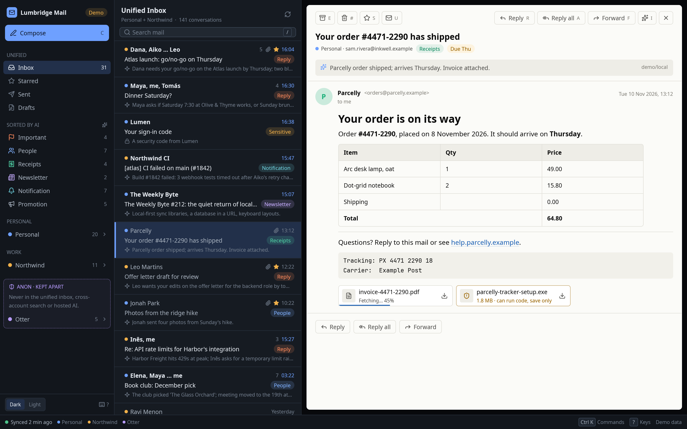
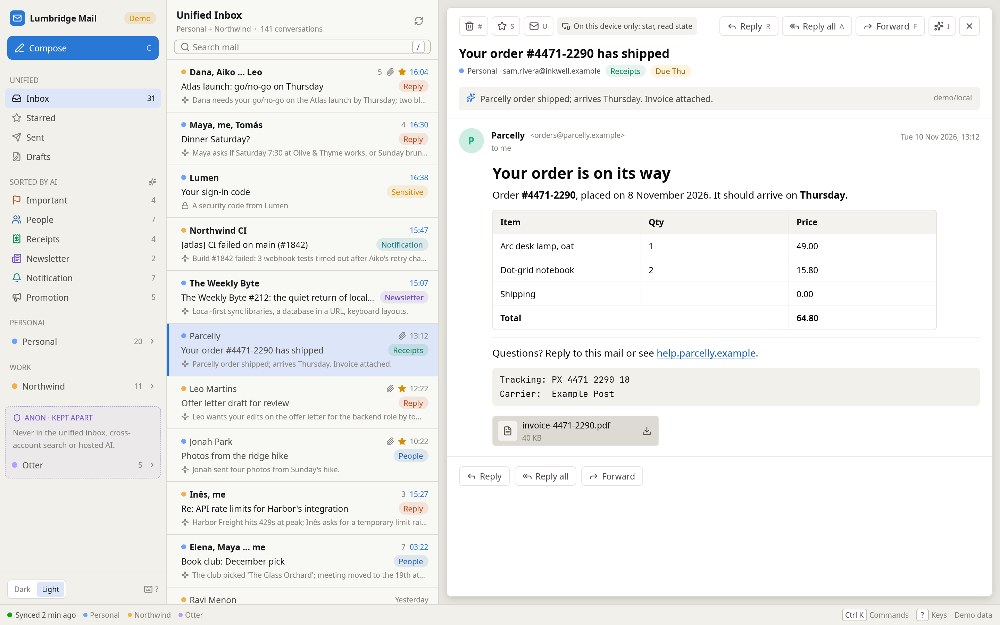
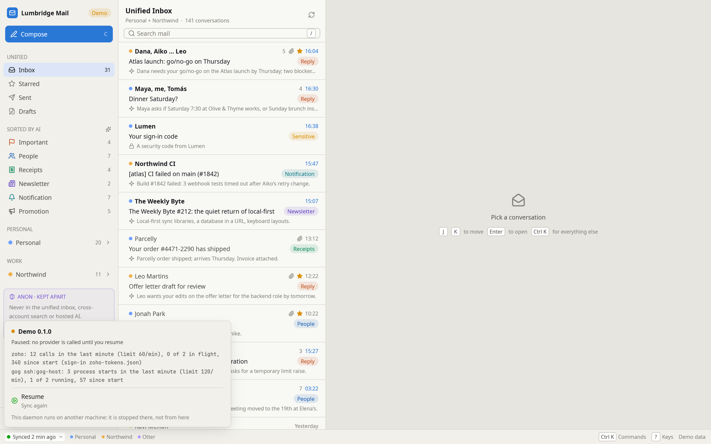

# lumbridge-mail-app

The Lumbridge Mail desktop app, binary `lumbridge-mail`. GPUI through `gpui-kit =0.9.1` from crates.io
(the `gpui-pre =0.3.12` snapshot family), nothing vendored. Three panes (sidebar, virtualised thread list,
reader on a paper card), a composer, a command palette, an AI side panel, light and dark.

It runs entirely on made-up mail with `--demo`; without it, it talks to `lumbridge-maild` over its socket
(and starts the daemon when none is running). Received mail is shown only through
`lumbridge-mail-render`'s block tree, painted natively; outgoing mail is made by its `compose`.

## Run

On a desktop machine with Rust 1.97:

    cargo run -p lumbridge-mail-app --release -- --demo                  # made-up mail, no daemon
    cargo run -p lumbridge-mail-app --release -- --demo --threads 50000  # a big made-up mailbox
    cargo run -p lumbridge-mail-app --release --                         # the daemon (started if needed)
    cargo run -p lumbridge-mail-app --release -- mailto:maya@x.example   # the composer, filled in
    cargo run -p lumbridge-mail-app --release -- --socket /path/maild.sock --light --undo-send 10

Arguments: `--demo [--threads N]`, `--socket PATH` (never auto-started), `--remote HOST` (a daemon on
another machine over ssh; `local` for this one), `--no-start`, `--light`/`--dark` (for this run; otherwise
the saved theme), `--undo-send SECONDS`, `--new-instance`, and a `mailto:` URL.

### The daemon

Which daemon (`src/backend/ssh.rs`, `ssh::target`): `--demo`; `--socket` (local, never started);
`--remote`, else `LBMAIL_REMOTE`, else `[daemon] remote` in `config.toml`; else this machine's, started
when missing. A remote daemon is reached with `Rpc::remote`: each connection runs
`ssh -T <host> lbmail pipe` after fetching the person token with `ssh <host> lbmail person-token`
(memory only); nothing is ever started or stopped, the status bar says "maild on <host>", a failed or
dropped ssh is `Problem::Remote` with what ssh said, and the link redials with the same backoff (a
connection that dies within 5 s counts as a failure). Attachments from a remote daemon are copied here in
512 KiB pieces (`message.attachment.read`) into this machine's cache, with progress (see "Attachments").
See docs/ARCHITECTURE.md, "Remote daemon".

Paths are core's (`lumbridge_mail_core::paths`, wrapped in `src/paths.rs`), so the app, the daemon and
`lbmail` agree: the socket is `$LUMBRIDGE_MAIL_HOME/maild.sock` when that is set, else
`$XDG_RUNTIME_DIR/lumbridge-mail/maild.sock` (`$TMPDIR/lumbridge-mail-<user>/` on macOS), with a short
`/tmp/lumbridge-mail-<hash>/` fallback when that path is too long for a Unix socket. The `Rpc` backend's
link manager (`src/backend/rpc.rs`):

- opens every connection with `hello` and the person token, read fresh from `person.token` next to the
  socket (the daemon writes a new one at each start), after checking with `SO_PEERCRED` / `getpeereid`
  that the daemon runs as our own user. Without it the daemon treats the app as an agent: no Send,
  sensitive mail only as its one line. `Rpc::agent` connects without the token (tests); the status bar
  says "Agent connection: sending is off" when the daemon did not take us for a person.

- dials the socket on the first request; if nothing listens there (and the socket is the default one,
  without `--no-start`) it starts `lumbridge-maild`, found next to the app's binary first (an install puts
  both there; on macOS inside the .app), then on `PATH`. It runs in its own process group with no
  arguments (that is all `lumbridge-maild` takes), inheriting `LUMBRIDGE_MAIL_HOME`; its output goes to
  `<data dir>/maild.log`. It is started
  at most once every 30 s and has 10 s to open its socket.
- reconnects with backoff (0.25 s up to 30 s) when the connection drops (the daemon restarted), and the
  window reloads when it is back. Requests made while down wait for the next attempt, then fail with
  `Error::Offline` and a plain reason.
- publishes a `LinkState` the status bar and the error panel show: connecting, starting, connected, or
  down with one of: not running, not installed (no `lumbridge-maild` found), did not start (exited, or no
  socket in time; see its log), socket unreachable (permissions), connection lost; and when it retries.

### Desktop

- One window per user: a second launch hands its `mailto:` (or "come to the front") to the first over
  `app.sock` next to the daemon's socket (`src/instance.rs`), then exits. macOS open-URL events go the
  same way.
- `mailto:` URLs (RFC 6068: to, cc, bcc, subject, body; nothing else) open the composer; nothing is sent
  until Send. Links to `mailto:` in mail do the same, from the account the message came to.
- Desktop notifications for new mail while the window is in the background: on by default, off for anon
  accounts unless turned on, and sensitive mail shows only its fixed line ("A security code from Brightdesk").
  `notify-send` on Linux, `osascript` on macOS, with the mail text as arguments (`src/notify.rs`).
- Window title "Lumbridge Mail", app id `com.lumbridgecorp.mail` (Wayland/X11 class, the `.desktop`
  name, the macOS bundle id). Icon: `deploy/app/icons/` (original; `make_icon.py` draws it).
- Settings in `<config dir>/app.json` (`~/.config/lumbridge-mail/app.json`, or `$LUMBRIDGE_MAIL_HOME/config`):
  theme, list density, notification choices, and the senders whose images load without asking. Change
  them with `secondary-shift-l` and the palette's Settings commands. `--demo` never writes them.

### First run

With the daemon up and no accounts, the window shows "Welcome to Lumbridge Mail" (`src/ui/setup.rs`):
**Try with demo mail** adds three made-up accounts (personal, work, anon) served by the daemon's demo
provider; **Add Gmail through gog** takes the address, your name, a persona and where gog runs (`gog`, a
path, or `ssh:<host>`), read-only ticked; **Add another account (IMAP)** takes the address, "Find servers"
fills IMAP/SMTP from `accounts.discover`, and the password goes to the daemon, which keeps it in the OS
keyring. Each is one `accounts.add` (the daemon writes `config.toml` and reloads); then the window
reloads.

### Read-only accounts

`Account.readonly` (config `readonly = true`) is shown with a lock in the sidebar and "Read-only account:
nothing changes on the server" in place of the reader's archive/trash/star/unread buttons. Keys that
would change it (`e`, `#`, `s`, `u`) say so in the status bar instead of failing; opening a thread does not
mark it read; Send from it is refused in the composer with the reason; drafts are not saved.

## Install

See the top-level README, "Install and run". Build all three binaries on the target platform
(`cargo build --release -p lumbridge-mail-app -p lumbridge-maild`), then:

    deploy/install-linux.sh [--bin-dir DIR] [--systemd] [--default-mailto]   # Linux, no sudo
    deploy/app/make-macos-app.sh [--binary PATH] [--install]                 # macOS, no sudo

Linux: `lumbridge-mail`, `lumbridge-maild` and `lbmail` go to `~/.local/bin`, icons to
`~/.local/share/icons/hicolor`, and `com.lumbridgecorp.mail.desktop` (a `mailto:` handler) to
`~/.local/share/applications`; `--systemd` adds the daemon's user unit (optional: the app starts the
daemon itself), `--default-mailto` makes it the default handler, `--uninstall` removes it all.
The release binary (built on Ubuntu 24.04) needs glibc 2.39 or newer and links libxcb,
libxkbcommon, libxkbcommon-x11 (plus libXau, libXdmcp, libxcb-xkb, libbsd, libmd); Wayland, Vulkan
(a driver: Mesa, or the GPU vendor's) and fontconfig are opened at run time. `notify-send` (libnotify)
shows desktop notifications. macOS: builds `Lumbridge Mail.app` with `lumbridge-maild` and `lbmail` in
`Contents/MacOS` (bundle id `com.lumbridgecorp.mail`, claims `mailto:`), signs it ad hoc, and with `--install` copies it to
`~/Applications` and registers it; pick it as the default mail app in Mail.app's settings.

On Linux, GPUI draws a variable font at one weight only, so with the variable Inter (the common way it is
installed now) there would be no bold; the app then uses the first of Noto Sans, Ubuntu, Cantarell,
Liberation Sans or DejaVu Sans that has a real bold face (`theme::pick_ui_font`). On Ubuntu 24.04 that is
Noto Sans, which is what the screenshots show.

Linux builds need the usual GPUI libraries (`libxkbcommon-x11`, Vulkan): see the top-level README for the
`apt` line.

## Tests

    cargo test -p lumbridge-mail-app        # unit tests, behaviour test, screenshot test
    cargo clippy -p lumbridge-mail-app --all-targets -- -D warnings

- Unit tests: the demo backend (anon wall, sensitive rule, send needs a person, search operators, 50k
  paging, the HTML stories through the renderer, made-up attachment files, contacts), the RPC client
  against in-test fake daemons (framing, out-of-order replies, events, a missing socket, autostart that
  waits for the socket, a daemon that exits at once, a restarted daemon found again, finding the binary),
  rendering and its summaries, image checks (formats, decompression bombs, no SVG) and the fetcher (no
  cookies or referrer, size cap, local addresses refused) against a loopback server, contacts behind the
  anon wall, compose (reply/forward quoting, plain vs formatted), mailto parsing, the single-instance
  hand-over, notification rules, settings (round trip, broken files), paths, arguments, local-time dates,
  the key table (and that this README lists every key).
- `tests/behaviour.rs`: the app in a headless GPUI, driven by real keystrokes: j/k/enter/escape, e/#/s/z,
  x and `g` keys, reply + send + undo send (with the test clock), AI draft (and that the reply is quoted
  by `compose`), palette, shortcuts, AI panel, search, sensitive mail, 50k paging, the reader on the
  renderer (blocked until `m`, then "Always for this sender" saved and honoured), anon image loads asking
  again, hostile mail (sender warnings, a deceptive link asks before opening), `cid:` images and a forward
  carrying the files, contact suggestions, notifications on and off, a mailto from a second instance.
- `crates/lumbridge-mail-e2e`: the same window against the real daemon (see its README).
- `tests/screenshots.rs`: real offscreen renders (GPUI's headless WGPU renderer; on a box without a GPU
  use Mesa's lavapipe: `VK_ICD_FILENAMES=/usr/share/vulkan/icd.d/lvp_icd.json`). Writes PNGs to
  `target/screenshots/` (or `$LBMAIL_SHOTS`) and checks a few pixels of each. `cargo test ... --test
  screenshots composer` renders only the shots whose name contains `composer`. No window opens on any
  display. Remote images in the "loaded" shots come from `remote::Painted` (drawn, no network). The
  committed copies are in `docs/screenshots/`.

| Shot | Shows |
|---|---|
| `reader-newsletter-blocked-light` | a layout-table newsletter, images blocked and trackers counted; Unsubscribe; verified sender |
| `reader-newsletter-loaded-dark` | the same after "Load images" |
| `reader-receipt-light` | a receipt with a data table (colspan), a rule and preformatted text |
| `reader-reply-chain-folded-dark`, `reader-reply-chain-open-light` | an Outlook reply chain, history folded and shown |
| `reader-phishing-light` | hostile mail: Reply-To and authentication chips, removed active content, deceptive links with their real targets, the hover line |
| `reader-inline-image-light` | a `cid:` image from the message's own parts |
| `composer-reply-quoted-light` | a reply in Markdown with the quoted original under the editor |
| `composer-suggestions-dark` | recipient suggestions |

## Keyboard

Single keys work when the list or the reader has focus; text fields keep their letters. The same table
drives the bindings, the palette and the `?` sheet (`src/keymap.rs`). `secondary` is Cmd on macOS and
Ctrl elsewhere.

| Keys | Does |
|---|---|
| `j` / `down`, `k` / `up` | next / previous conversation (moves the reader too when it is open) |
| `enter` / `o` | open |
| `escape` | back: close palette or sheet, leave search, clear selection, close the reader |
| `x` | select the conversation under the cursor (shift-click a range, ctrl-click to toggle) |
| `* a`, `* n` | select all loaded, clear the selection |
| `e` | archive |
| `#` (or `delete`) | move to Trash |
| `s` | star / unstar |
| `u` | read / unread |
| `z` | undo the last change (or a send that is still waiting) |
| `r`, `a`, `f` | reply, reply all, forward |
| `c` | compose |
| `secondary-enter` | send (in the composer) |
| `secondary-shift-a` | attach a file (in the composer) |
| `secondary-shift-c` | show Cc and Bcc (in the composer) |
| `/` | search (operators: `from:` `to:` `subject:` `has:attachment` `is:unread` `is:starred` `in:` `before:` `after:`) |
| `secondary-k` | command palette (`ctrl-k` too) |
| `?` | keyboard shortcuts |
| `g i` | Unified Inbox |
| `g !` | Important |
| `g s`, `g t`, `g d`, `g a`, `g #` | Starred, Sent, Drafts, Archive, Trash (in the account in view, else unified) |
| `i` | AI panel |
| `m` | load remote images in the open message |
| `;` | expand every message in the thread |
| `shift-r` | sync now |
| `secondary-shift-l` | light / dark |
| `secondary-shift-o` | work offline (demo only: actions queue, the status bar shows it) |

## How it is put together

| Path | What |
|---|---|
| `src/backend/mod.rs` | the `Backend` trait: one async method per `core::rpc::method`, `Send` futures that need no runtime, plus `events()` |
| `src/backend/demo/` | `Demo`: three accounts (personal, work, anon), hand-written stories (long threads, receipts, newsletters with remote images, a security code, attachments) then template filler generated lazily by index. Acts like the daemon: actions change it and raise `Event`s; sends need `Caller::Person`; sensitive mail is never summarised or drafted from; anon is never in unified views or `ai.ask`. Made-up names, `.example` domains only. |
| `src/backend/rpc.rs` | `Rpc`: JSON-RPC 2.0, one object per line, over the Unix socket; a reader and a writer thread and a pending-request table, so futures only wait on a oneshot. Notifications go to `events()`. A link-manager thread dials, starts the daemon, reconnects with backoff and publishes `LinkState` (see "The daemon"). |
| `src/app.rs` | `MailApp`: state, loading (pages of 200, the next page near the end of the list), actions with optimistic updates and undo, the composer's send with an undo delay, the AI panel, overlays |
| `src/ui/` | drawing, one file per area: `sidebar`, `list` (`uniform_list`), `reader`, `composer`, `ai`, `overlays` (palette, shortcuts), `mod.rs` (window + status bar) |
| `src/reading.rs` | bodies through `lumbridge-mail-render` (`blocks`, `header_info`), the images a document needs, the blocked/removed summaries, sender warnings |
| `src/remote.rs` | image checks before GPUI decodes anything, the remote-image fetcher (ureq), `Painted` stand-ins |
| `src/contacts.rs`, `src/mailto.rs`, `src/notify.rs`, `src/instance.rs`, `src/settings.rs`, `src/paths.rs`, `src/cli.rs` | suggestions, mailto, notifications, one window, settings, paths, arguments |
| `src/theme.rs` | the palette (from `~/src/applied-research-1`) and the gpui-kit theme to match |

Components from gpui-kit: `Input`/`Textarea` (search, recipients, subject, body, AI boxes), `Command` (the
palette), `Button`, `Skeleton`, `Root`; lists use GPUI's `uniform_list`.

### Swapping the backend

The window only sees `Arc<dyn Backend>`. `main.rs` picks `Demo` for `--demo`, else `Rpc::new(socket)`.
When the daemon lands nothing else changes: the app already sends `Caller::Person` on every `act`,
re-runs its query on `Event::Changed`, and shows `Event::Status` / `NewMail` / `ActionFailed`. To add a
transport (say the socket over the tailnet), implement `Backend` or hand `Rpc::from_stream` a connected
stream.

### The reader

`reading::render(&Body, from, remote)` is the only way the reader turns a body into something to paint:
`lumbridge_mail_render::blocks` with `Policy::default()` (remote blocked) or `Policy::remote_allowed()`,
plus `header_info`. It runs off the UI thread when a body arrives and again when images are allowed.
`ui/reader.rs::Painter` is the only painter: paragraphs and headings as styled text (bold, italic, code in
the monospace font, strike, links in the link colour; a link with a `warning` is red and followed by its
real destination inline), nested lists, quotes with a bar per depth (indent capped at 4), code blocks,
tables as a grid (`colspan`, header rows), rules, and images. Hovering a link shows its full address at
the foot of the card; a deceptive link asks before it opens; `mailto:` links open the composer.

Images: `Blocked` ones are placeholders the size the image would be; `cid:` parts are fetched through
`Backend::attachment` and `data:` ones decoded at once; `Remote` ones exist only after the person asked
and are fetched by `remote::Http`: no cookies, no referrer, a generic user agent, 3 redirects, 5 s to
connect and 15 s in all, 5 MiB per image, 40 per message, public addresses only (never this machine, the
LAN or the tailnet). Every image is checked (PNG, JPEG, GIF or WebP, never SVG; at most 12000 px a side and
40 Mpx) before GPUI decodes it. "Load images" is for this message; "Always for this sender" saves the
address; on an anon account every load is confirmed again and senders are never remembered.

Attachments: a chip per file. Click it to open the file with the system's program (`files::System`:
`xdg-open` / `open`, the path as one argument), or the download button to save a copy to Downloads
(`$XDG_DOWNLOAD_DIR`, else `~/Downloads`; never overwriting, `report (2).pdf`). Both fetch through
`Backend::attachment_progress`: the daemon's cache path locally; from a remote daemon the bytes are copied
in pieces into `<cache>/attachments/remote/<hash>/<safe name>` (0600 in 0700 directories, written under a
temporary name, refused over 256 MiB) while the chip shows "Fetching… N%" and a bar. Names go through
`core::files::safe_file_name`; nothing gets an executable bit; what `core::files::dangerous_to_open` flags
(programs, scripts, installers, macro documents) is never opened: its chip says "can run code, save only"
and clicking it saves.

What an account can do comes from the daemon's `accounts.capabilities` (`Backend::capabilities`, loaded
with the accounts; the demo reports none, meaning everything on the server) and `Account::readonly`, as
`MailApp::offer(account, Verb) -> Offer`: `Hidden` (unsupported: not in the toolbar or the selection bar;
the key says the account cannot), `Local` (shown, with an "On this device only: ..." chip; its toast says
so), `Disabled` (a read-only account: archive, trash, star and read are drawn dimmed and unclickable with
a "Read-only account" chip; the key explains), `Server`. Reply stays on a read-only account (another
address can send it); it is hidden when the account cannot send.

### The daemon menu

Click the sync state at the left of the status bar: the daemon's name and version, whether it runs or is
paused, each provider budget's load line in its own words (`ProviderLoad::describe`: gog process starts
per host, Zoho calls per sign-in), and Pause / Resume (`daemon.pause` / `daemon.resume`). Quit
(`daemon.quit`) is offered only for a daemon on this machine (`Backend::can_quit_daemon`); a remote
daemon belongs to its server's service manager, so the menu says to stop it there and `Rpc::quit_daemon`
refuses.

Header facts: an Unsubscribe button when the mail has `List-Unsubscribe` (a mailto becomes a draft you
send; otherwise the sender's page opens in the browser; the app makes no request itself), red chips when
Reply-To goes to another domain or authentication failed, "verified" when DMARC (or aligned DKIM) passed.

### The composer

The editor holds only what you write (Markdown-ish: `**bold**`, `_italic_`, lists, quotes, links). The
original of a reply or forward is a `lumbridge_mail_render::Original` (its date in your time zone),
previewed under the editor, and `compose` makes the parts: text + HTML in Formatted mode (the default), text
only in Plain mode, the original quoted in both. A forward carries the original's files (saved to local
paths through `Backend::attachment`; Send waits for them). Recipient suggestions come from the people in
the mail the app has seen and `Backend::contacts`; writing from an anon account suggests only that
account's people, and anon people are never suggested anywhere else.

## What is real and what is stubbed

Real: everything in the window, on the demo; the reader on `lumbridge-mail-render` (HTML and text);
outgoing parts from `compose`; remote images after a click; the RPC client with the person token, daemon
start and reconnect, tested against in-test fakes and against the real `lumbridge-maild` in
`crates/lumbridge-mail-e2e` (the window driven by keys on the daemon, autostart of the real binary);
first run; read-only accounts; notifications, mailto,
one window, settings, local time; the safety rules on the app side (send only from the Send button as a
person, sensitive mail kept out of the AI panel and notifications, anon never in unified views, answers or
other accounts' suggestions, remote content only after a click, re-confirmed for anon).

Stubbed or missing:
- Contacts: core has no method, so `Rpc` suggests only people from mail the window has loaded.
- Accounts can be added from the window but not edited or removed there (`lbmail account remove`).
- Unsubscribe never makes the RFC 8058 one-click POST itself (that would be a request the app makes on its
  own); it drafts the mailto or opens the page.
- Images are fetched by the app, not the daemon, so they are not cached across runs.
- No drag and drop, no printing, no "view source"; no live preview of Formatted mode while writing.

Reference code: the three-pane layout follows overlook (MIT) and aviary (Apache-2.0) in spirit; no code
was copied from either, nor from any GPL or unlicensed client.

## Open: the macOS titlebar in dark mode

The titlebar is the system's (`lib.rs` `window_options`: `TitlebarOptions { title, ..Default }`), so AppKit
draws it in the window's `NSAppearance`, which follows the system setting, not the app's own theme
(`settings.theme`, `--dark`). With macOS in Light and the app in Dark, the titlebar stays light. GPUI
0.3.12 (gpui-kit 0.9.1) has no call to set a window's `NSAppearance`. Not changed without a Mac to check
it on. Two ways, either needs a look on macOS:

1. Draw our own titlebar, as Zed does: on macOS only, `TitlebarOptions { appears_transparent: true,
   traffic_light_position: Some(point(px(12.), px(12.))) }`, and a 28 px drag strip in `p.chrome` across
   the top of the window (`WindowControlArea::Drag`), with the sidebar's header moved below the traffic
   lights. It then follows the app's theme. Check: traffic lights not over the "Lumbridge Mail" header,
   double-click on the strip zooms, full screen hides the strip.
2. Set the appearance natively: after `open_window`, `[ns_window setAppearance: [NSAppearance
   appearanceNamed: NSAppearanceNameDarkAqua]]` (or `nil` for "follow the system") from the raw window
   handle (`objc2-app-kit`), again when the theme setting changes.

If the report was with macOS itself in Dark, first check the bundle's Info.plist (`deploy/app`) has no
`NSRequiresAquaSystemAppearance` (it has none today).
