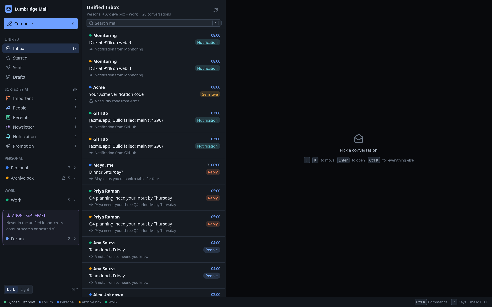

# lumbridge-mail-e2e

Tests only: the GPUI app (`lumbridge-mail-app`) through its real `Rpc` client against the real daemon
(`lumbridge-maild`), headless. Made-up mail only; no window on any display, no network, no real keyring.

    cargo test -p lumbridge-mail-e2e                 # all three
    cargo test -p lumbridge-mail-e2e --test app_on_daemon

- `src/lib.rs`, the harness. `MailEnv`: the daemon library (what the binary runs) on a temp
  `LUMBRIDGE_MAIL_HOME`, with the daemon's `DemoProvider`s held here (so a test can see what reached "the
  server": flags, mailboxes, Sent) and a `ScriptedModel`; each start gets its own tokio runtime, so
  `kill()` drops it like a crash. `Window`: `MailApp` on GPUI's headless test platform, driven by keys.
- `tests/app_on_daemon.rs`: list, anon wall, read-only flag, category badges (`counts`), suspicious mail;
  open a thread, body through the renderer, read on the server; `s`/`e`/`z` through the daemon's queue and
  back as events (undo of an archive is `Move { from: None }`); `/` search; AI panel summary, `ai.extract`,
  ask; reply + Send as a person lands in the demo provider's Sent; read-only account refuses with an
  explanation and nothing reaches its server; `resync_needed` after a forgotten history; an agent
  connection (no token) sees sensitive mail as one line and has Send refused; the daemon killed and
  restarted, the app reconnects with the new token; first run (demo mail, gog read-only, IMAP with
  discovery and the password only in the keyring stand-in).
- `tests/autostart.rs`: `Rpc` starts the real `lumbridge-maild` binary (needs it built next to the test,
  as `cargo test --workspace` does), on a home deep enough to need the `/tmp` socket fallback.
- `tests/shots_on_daemon.rs`: offscreen PNGs `daemon-*` in `target/screenshots/` (inbox, reader, AI panel,
  suspicious mail, read-only account, agent + sensitive, first run). Copies in `docs/screenshots/`.

The installed layout was also run by hand on an Ubuntu 24.04 machine (temp `HOME`, `deploy/install-linux.sh`, the
release binaries under Xvfb with Mesa's lavapipe, never the real display): `installed-inbox-xvfb.png` (the
app on a daemon driven by `lbmail`) and `installed-first-run-xvfb.png` (a fresh home: the app started the
installed `lumbridge-maild` itself and offered first run).
